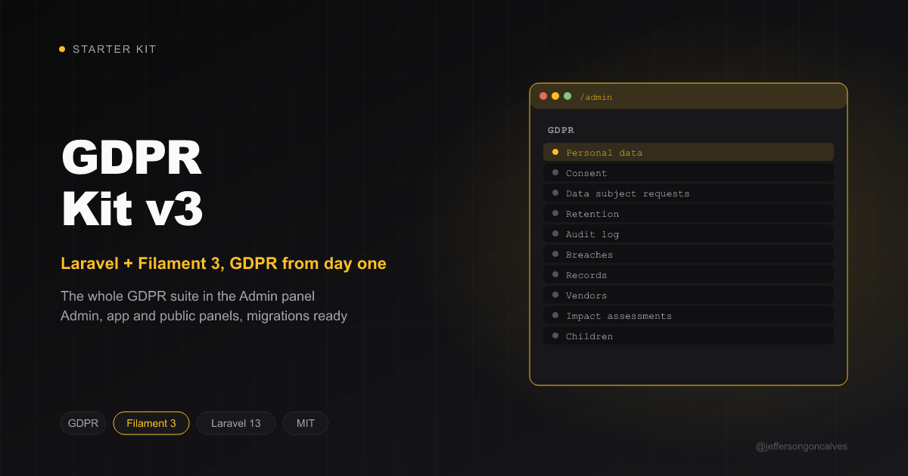

<div class="filament-hidden">



</div>

# GdprKit Start Kit Filament 3.x and Laravel 12.x

[](https://buymeacoffee.com/jeffersongoncalves)

## About GdprKit

GdprKit is a robust starter kit built on Laravel 12.x and Filament 3.x, designed to accelerate the development of modern
web applications with a ready-to-use multi-panel structure and the GDPR privacy suite already installed: the tooling for
the EU General Data Protection Regulation (GDPR), managed from the Admin panel.

## Features

- **Laravel 12.x** - The latest version of the most elegant PHP framework
- **Filament 3.x** - Powerful and flexible admin framework
- **Multi-Panel Structure** - Includes three pre-configured panels:
    - Admin Panel (`/admin`) - For system administrators
    - App Panel (`/app`) - For authenticated application users
    - Public Panel (frontend interface) - For visitors
- **GDPR privacy suite** - every `laravel-gdpr*` package and its `filament-gdpr*` plugin (1.x), wired into the Admin panel
- **Environment Configuration** - Centralized configuration through the `config/gdprkit.php` file

## System Requirements

- PHP 8.2 or higher
- Composer
- Node.js and PNPM

## Installation

Clone the repository
``` bash
laravel new my-app --using=jeffersongoncalves/gdprkitv3 --database=mysql
```

### Using FilaKit CLI

Or use [FilaKit CLI](https://github.com/jeffersongoncalves/filakit-cli) for a simplified setup:

```bash
filakit new my-app --kit=jeffersongoncalves/gdprkitv3
```

> Install FilaKit CLI: `composer global require jeffersongoncalves/filakit-cli`

###  Easy Installation

GdprKit can be easily installed using the following command:

```bash
php install.php
```

This command automates the installation process by:
- Installing Composer dependencies
- Setting up the environment file
- Generating application key
- Setting up the database
- Running migrations
- Installing Node.js dependencies
- Building assets
- Configuring Herd (if used)

### Manual Installation

Install JavaScript dependencies
``` bash
pnpm install
```
Install Composer dependencies
``` bash
composer install
```
Set up environment
``` bash
cp .env.example .env
php artisan key:generate
```

Configure your database in the .env file

Run migrations
``` bash
php artisan migrate
```
Build frontend assets
``` bash
pnpm run build
```
Run the server
``` bash
php artisan serve
```

## Installation with Docker

Clone the repository
```bash
laravel new my-app --using=jeffersongoncalves/gdprkitv3 --database=mysql
```

Move into the project directory
```bash
cd my-app
```

Install Composer dependencies
```bash
composer install
```

Set up environment
```bash
cp .env.example .env
```

Configuring custom ports may be necessary if you have other services running on the same ports.

```bash
# Application Port (ex: 8080)
APP_PORT=8080

# MySQL Port (ex: 3306)
FORWARD_DB_PORT=3306

# Redis Port (ex: 6379)
FORWARD_REDIS_PORT=6379

# Mailpit Port (ex: 1025)
FORWARD_MAILPIT_PORT=1025
```

Start the Sail containers
```bash
./vendor/bin/sail up -d
```
You won’t need to run `php artisan serve`, as Laravel Sail automatically handles the development server within the container.

Attach to the application container
```bash
./vendor/bin/sail shell
```

Generate the application key
```bash
php artisan key:generate
```

Install JavaScript dependencies
```bash
pnpm install
```

## GDPR privacy suite

The kit ships the whole GDPR suite for the EU General Data Protection Regulation (GDPR):

| Package | Filament plugin |
|---|---|
| [laravel-gdpr](https://github.com/jeffersongoncalves/laravel-gdpr) | [filament-gdpr](https://github.com/jeffersongoncalves/filament-gdpr) |
| [laravel-gdpr-consent](https://github.com/jeffersongoncalves/laravel-gdpr-consent) | [filament-gdpr-consent](https://github.com/jeffersongoncalves/filament-gdpr-consent) |
| [laravel-gdpr-dsar](https://github.com/jeffersongoncalves/laravel-gdpr-dsar) | [filament-gdpr-dsar](https://github.com/jeffersongoncalves/filament-gdpr-dsar) |
| [laravel-gdpr-retention](https://github.com/jeffersongoncalves/laravel-gdpr-retention) | [filament-gdpr-retention](https://github.com/jeffersongoncalves/filament-gdpr-retention) |
| [laravel-gdpr-audit-log](https://github.com/jeffersongoncalves/laravel-gdpr-audit-log) | [filament-gdpr-audit-log](https://github.com/jeffersongoncalves/filament-gdpr-audit-log) |
| [laravel-gdpr-breaches](https://github.com/jeffersongoncalves/laravel-gdpr-breaches) | [filament-gdpr-breaches](https://github.com/jeffersongoncalves/filament-gdpr-breaches) |
| [laravel-gdpr-records](https://github.com/jeffersongoncalves/laravel-gdpr-records) | [filament-gdpr-records](https://github.com/jeffersongoncalves/filament-gdpr-records) |
| [laravel-gdpr-vendors](https://github.com/jeffersongoncalves/laravel-gdpr-vendors) | [filament-gdpr-vendors](https://github.com/jeffersongoncalves/filament-gdpr-vendors) |
| [laravel-gdpr-dpia](https://github.com/jeffersongoncalves/laravel-gdpr-dpia) | [filament-gdpr-dpia](https://github.com/jeffersongoncalves/filament-gdpr-dpia) |
| [laravel-gdpr-children](https://github.com/jeffersongoncalves/laravel-gdpr-children) | [filament-gdpr-children](https://github.com/jeffersongoncalves/filament-gdpr-children) |

- `App\Models\User` is the data subject: it implements `HasPersonalData` and declares its `name` and `email` with `#[PersonalData]`.
  Declare every personal column you add, on this model and on your own models, and list those models in `config/gdpr.php`.
- The migrations are already in `database/migrations`: `php artisan migrate` creates every table of the suite.
- Every plugin is registered in `app/Providers/Filament/AdminPanelProvider.php`, under the **GDPR** navigation group.
- `tests/Feature/GdprSuiteTest.php` checks the declarations and opens every page of the suite.

Each package's README explains its configuration, events and scheduled commands. The suite gives you tooling: it does not make
you compliant on its own, you still need legal review.

## Authentication Structure

GdprKit comes pre-configured with a custom authentication system that supports different types of users:

- `Admin` - For administrative panel access
- `User` - For application panel access

## Development

``` bash
# Run the development server with logs, queues and asset compilation
composer dev

# Or run each component separately
php artisan serve
php artisan queue:listen --tries=1
pnpm run dev
```

## Customization

### Panel Configuration

Panels can be customized through their respective providers:

- `app/Providers/Filament/AdminPanelProvider.php`
- `app/Providers/Filament/AppPanelProvider.php`
- `app/Providers/Filament/PublicPanelProvider.php`

Alternatively, these settings are also consolidated in the `config/gdprkit.php` file for easier management.

### Themes and Colors

Each panel can have its own color scheme, which can be easily modified in the corresponding Provider files or in the
`gdprkit.php` configuration file.

### Configuration File

The `config/gdprkit.php` file centralizes the configuration of the starter kit, including:

- Panel routes
- Middleware for each panel
- Branding options (logo, colors)
- Authentication guards

## Resources

GdprKit includes support for:

- User and admin management
- Multi-guard authentication system
- Tailwind CSS integration
- Database queue configuration
- Customizable panel routing and branding

## License

This project is licensed under the [MIT License](LICENSE).

## Security headers

Every panel response carries baseline security headers from [laravel-security-headers](https://github.com/jeffersongoncalves/laravel-security-headers) (the `SecurityHeaders` middleware is the first entry in each panel's `->middleware([...])`):

- `X-Content-Type-Options: nosniff`, `X-Frame-Options: SAMEORIGIN`, `Referrer-Policy: strict-origin-when-cross-origin`, `Permissions-Policy`, `Cross-Origin-Opener-Policy`
- `Strict-Transport-Security` over HTTPS outside the `local` environment (configure `trustProxies` behind a TLS-terminating proxy)
- a `Content-Security-Policy` that keeps scripts, styles, fonts, frames and form posts first-party. Filament needs `'unsafe-inline'` and `'unsafe-eval'` in `script-src`, so it is **not** an XSS defence — escape and sanitize anything user-supplied. The CSP is disabled in `local` so the Vite dev server works.

Defaults live in `config/security-headers.php`. Admins can change them at runtime in **Settings → Security headers** ([filament-security-headers](https://github.com/jeffersongoncalves/filament-security-headers)); saved values override the config, and **Reset to config** goes back. Allow any third-party origin you add (analytics, chat widgets, CDNs) in the matching directive, and try a stricter policy with report-only first.

## Credits

Developed by [Jefferson Gonçalves](https://github.com/jeffersongoncalves).
